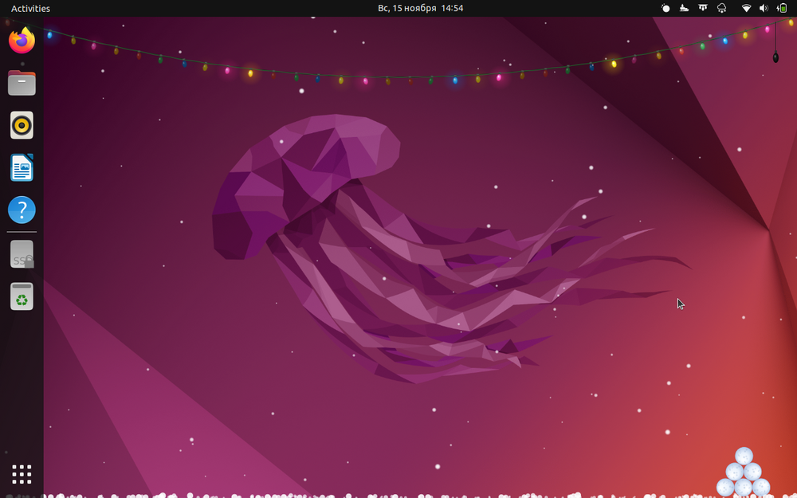
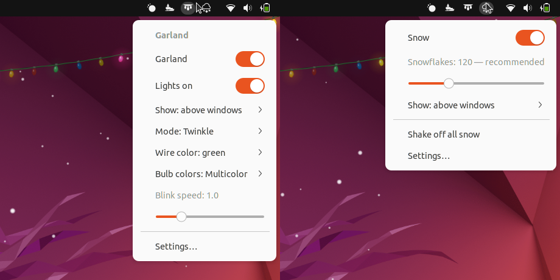

# ❄ ng-gnome-extensions

Snow, a garland, Ded Moroz on a sleigh and snowballs for the GNOME desktop.
Снег, гирлянда, Дед Мороз на санях и снежки для рабочего стола GNOME.



**[English](#english) · [Русский](#русский)**

---

## English

### Install

Open a terminal and run:

```bash
git clone https://github.com/mpreterer/ng-gnome-extensions.git
cd ng-gnome-extensions
./install.sh
```

Then restart GNOME Shell:

- **X11** (default on Ubuntu 22.04 with NVIDIA, or if you chose “Ubuntu on Xorg”): press `Alt+F2`, type `r`, press `Enter`.
- **Wayland**: log out and log back in.

That’s it. Four icons appear on the top bar — click any of them to control it or open **Settings…**

### What you get

| | Extension | What it does | Hotkey |
|---|---|---|---|
| ❄ | **Snowfall Physics** | Snow falls, settles on window title bars and the bottom of the screen, falls off when you shake, minimize or close a window | `Super+Alt+X` |
| 💡 | **Garland Lights** | A blinking garland along the top of the screen; pull the cord on the right to switch the lights | `Super+Alt+G` |
| 🛷 | **Ded Moroz Sleigh** | Ded Moroz on a reindeer sleigh rides along the bottom of the screen every few hours | `Super+Alt+D` — ride now |
| ⚪ | **Snowball Fight** | A pile of snowballs on the desktop: grab one with the mouse and throw it | `Super+Alt+B` |

Each one can be shown **above windows**, **only on an empty desktop**, or **below windows**.
The language (English / Russian) follows your system; you can change it in **Settings…**

### Uninstall

```bash
cd ng-gnome-extensions
./uninstall.sh
```

### Requirements

GNOME Shell **42** (Ubuntu 22.04). Other versions are not tested.

If something goes wrong, turn off one extension:

```bash
gnome-extensions disable snowfall-physics@local
```

(the others: `garland-lights@local`, `ded-moroz-sleigh@local`, `snowball-fight@local`)

---

## Русский

### Установка

Откройте терминал и выполните:

```bash
git clone https://github.com/mpreterer/ng-gnome-extensions.git
cd ng-gnome-extensions
./install.sh
```

Затем перезапустите GNOME Shell:

- **X11** (по умолчанию в Ubuntu 22.04 с видеокартой NVIDIA или если выбран «Ubuntu on Xorg»): нажмите `Alt+F2`, введите `r`, нажмите `Enter`.
- **Wayland**: выйдите из системы и войдите снова.

Всё. На верхней панели появятся четыре значка — нажмите на любой, чтобы управлять им или открыть **Настройки…**

### Что внутри

| | Расширение | Что делает | Клавиши |
|---|---|---|---|
| ❄ | **Снег** | Падает, оседает на заголовках окон и внизу экрана, осыпается, если окно трясти, свернуть или закрыть | `Super+Alt+X` |
| 💡 | **Гирлянда** | Мигающая гирлянда вдоль верха экрана; потяните шнурок справа, чтобы включить или выключить свет | `Super+Alt+G` |
| 🛷 | **Дед Мороз** | Раз в несколько часов проезжает на санях с оленями по низу экрана | `Super+Alt+D` — проехать сейчас |
| ⚪ | **Снежки** | Горка снежков на рабочем столе: хватайте мышью и бросайте | `Super+Alt+B` |

Каждое можно показывать **поверх окон**, **только на пустом рабочем столе** или **под окнами**.
Язык (русский / английский) берётся из системы, его можно поменять в **Настройках…**

### Удаление

```bash
cd ng-gnome-extensions
./uninstall.sh
```

### Требования

GNOME Shell **42** (Ubuntu 22.04). На других версиях не проверялось.

Если что-то пошло не так, выключите одно расширение:

```bash
gnome-extensions disable snowfall-physics@local
```

(остальные: `garland-lights@local`, `ded-moroz-sleigh@local`, `snowball-fight@local`)

---



